<p align="center"></p>

# sign-off-review

An agent skill that decides whether a draft can go out. It reads the draft from five independent seats, ties out every number, checks for an outside view and runs a premortem. It returns a severity-ranked findings table and one of three verdicts: **Return**, **Release with fixes** or **Release**. A standard-library Python validator enforces the verdict rules, so a slip in the model's reasoning cannot release a draft that should go back.

The skill reviews. It does not rewrite. Prose cleanup is a separate [avoid-ai-writing](#with-avoid-ai-writing) run.

## Install

The skill is the repository root: `SKILL.md`, `references/` and `scripts/`. The `evals/`, `tests/` and `.github/` folders are for development, and the agent does not load them.

Claude Code, for every project:

```
git clone https://github.com/andrewluxem/sign-off-review ~/.claude/skills/sign-off-review
```

Claude Code, for one project (run from the project root):

```
git clone https://github.com/andrewluxem/sign-off-review .claude/skills/sign-off-review
```

Claude apps that accept skill uploads: build a zip that holds only the skill files, then upload it as a custom skill.

```
git archive --format=zip --prefix=sign-off-review/ -o sign-off-review.zip HEAD SKILL.md references scripts LICENSE NOTICE
```

The validator needs Python 3.9 or newer and no packages. The skill makes no network calls of its own and sends nothing anywhere. Its only write is the review file, saved next to the draft. Under the dry-run-gate convention, it declares no `side-effects`.

## Use

Ask in plain words:

- "Sign off on drafts/boise-memo.md before it goes to the committee."
- "Review my resume and cover letter against this job description before I apply."
- "Is this build plan ready for a fresh agent? It is an outline, stage 2."
- "Re-review drafts/boise-memo.md against drafts/boise-memo.review-2026-10-23.md."

The skill asks only for what it cannot infer (the draft, the question, the profile, the stage, and for job-search the target role) and otherwise proceeds with flagged assumptions. A draft passed as a file gets its review saved next to it as `<stem>.review-YYYY-MM-DD.md`. A pasted draft gets the review in chat.

## Profiles

The five seats stay fixed, so findings stay comparable across documents. The profile changes the questions each seat asks. Checks live in `references/profiles/<profile>.md`.

| Profile | For | Decision | Logic | Evidence | Skeptic | Outsider |
|---|---|---|---|---|---|---|
| `strategy` | memos, plans, decks | decision maker: the answer on page 1, with who, what and when | structure; the recommendation follows; alternatives ruled out | sources, dates, units; two kinds of evidence; contrary evidence | CFO: numbers tie, outside view, downside case | non-specialist |
| `pitch` | consulting proposals, outreach | economic buyer: what I get, what it costs, why you, why now, all on the first screen | scope, steps and outcome line up | every result claimed is the author's own, citable, NDA-safe, with a baseline and timeframe | procurement: exclusions, who does the work, risk, price logic | non-specialist outside CRM and lifecycle |
| `brief-post` | newsletter briefs, LinkedIn posts | busy reader: the thesis lands before the fold and says what to do differently | the argument chains; no leap from anecdote to rule | every external fact carries the URL actually fetched; no vague attributions | dissenting practitioner: is the strongest counterargument met | non-specialist; line-level AI tells go to avoid-ai-writing |
| `job-search` | resume, cover letter, LinkedIn About, interview stories | hiring manager on a six-second scan: is fit for this role clear at the top | one positioning across all documents; each bullet supports it | each metric has scope, baseline, timeframe and the candidate's share | recruiter: dates, gaps, tenure, titles, keyword coverage for the JD | non-specialist sees the business impact |
| `build-plan` | specs, run sheets, prompts for coding agents | owner: done-when, scope, non-goals | step order, dependencies, nothing missing | every path, flag, key and version cites file:line or carries a discovery command | operator: failure modes, rollback, backups, cost, security, decisions on record | fresh agent with no chat history: could it execute this |

Stages: `1` framing, `2` outline or plan, `3` final (the default). Stages 1 and 2 run only the Decision and Logic seats.

## Output

```
# Sign-off review: <document>, profile <profile>, stage <1|2|3>
**Verdict:** Return | Release with fixes | Release
**In one line:** ...
**Question:** ... (given | reconstructed, assumption)
**Answer the draft gives:** ...
## Findings
| # | Severity | Seat | Where | Problem | Consequence | Fix |
## Numbers that do not tie
| Number | Location A | Location B | Difference |
## Missing outside view
## Premortem
## What is good and must survive
## What fixed looks like        (only when Return)
```

Verdict rules, in order: any open Blocker means Return; any row under "Numbers that do not tie" means Return; any Major means Release with fixes; otherwise Release. Majors alone never force Return. Severity definitions, calibration and false alarms are in `references/severity.md`.

## The validator

```
python3 scripts/check_report.py drafts/boise-memo.review-2026-10-23.md
python3 scripts/check_report.py --selftest
```

| Exit | Meaning |
|---|---|
| 0 | valid |
| 1 | rule violations, each printed as `PATH:LINE: message` |
| 2 | file unreadable, or the first non-blank line is not a review header |

It checks the ten rules listed in `references/severity.md`: header, verdict, severities and seats, consequences, forced Return, the fixed picture, a three-item premortem with an internal cause, something good, fixes written as instructions, and no em dashes. It also flags missing template fields and sections, and in a re-review, prior findings left open but dropped from Findings. The skill tells the agent to run it on every review and fix violations before returning.

## With gauntlet-loop

gauntlet-loop pushes work past a first draft: a builder and a fresh critic each round, and the critic returns exactly one gap. sign-off-review returns a full ranked list in one pass. The two fit together when sign-off-review plays gauntlet's **measurement critic** (Template B in gauntlet's `references/critic-brief.md`).

- **Bar.** "sign-off-review returns Release or Release with fixes under profile `<profile>` at stage `<n>`, and `check_report.py` exits 0 on the review." Use "returns Release" for a stricter bar.
- **Critic.** Each round, a fresh subagent runs sign-off-review on the current artifact. It gets the artifact, the question and the profile. It does not get earlier reviews or the builder's notes. Gauntlet critics carry no history, so run a full review each round, not a re-review.
- **Forward only the top finding.** The orchestrator passes finding 1 (Blockers sort first, tie-out Blockers included) to the builder verbatim: its Where, Problem and Fix. The rest of the table stays with the orchestrator. This keeps gauntlet's one-gap-per-round rule intact.
- **Stop.** When the verdict meets the bar, the piece is done. If the same root cause stays at finding 1 for three rounds, gauntlet's convergence guard applies: rebuild that piece instead of patching it again.

gauntlet-loop needs no change for this. At most, its README gets a one-line "Related" pointer to this skill.

## With avoid-ai-writing

The two skills split the work. sign-off-review judges substance: the answer, the logic, the evidence, the numbers, the risk. avoid-ai-writing fixes prose at the line level. The order:

1. Run sign-off-review on the draft.
2. Apply its fixes. Re-review until the verdict is Release or Release with fixes.
3. Run avoid-ai-writing on the revised draft.
4. If avoid-ai-writing changed a number or a claim, re-review once more.

Polishing a draft that will come back as Return wastes the pass, so avoid-ai-writing waits until the substance holds. When the review notices AI tells, it records at most one Minor finding whose fix is "Run avoid-ai-writing on the revised draft", and it never rewrites the sentences itself.

## Evals

Six hand-run cases in `evals/`, one per profile plus a false-alarm case, each with planted defects, expected severities and must and must-not criteria. All inputs are fictional. See `evals/README.md`.

## Development

```
python3 -m unittest
python3 scripts/check_report.py --selftest
```

CI (`.github/workflows/test.yml`) runs both on Python 3.9 and 3.13 on `ubuntu-latest`. The actions are pinned to full commit SHAs:

- `actions/checkout` v7.0.1: `3d3c42e5aac5ba805825da76410c181273ba90b1`
- `actions/setup-python` v7.1.0: `6d4fd22b20465ccc0f7354476588e8df7c9ca0e0`

The repository has no em dashes anywhere. A unit test enforces this.

## Prior art

The five-seat review structure follows the partner-review skill in [aipiratesMunich/open-strategy-firm](https://github.com/aipiratesMunich/open-strategy-firm) (MIT); this is a fresh implementation that reproduces none of its text or code.

## License

MIT. See `LICENSE` and `NOTICE`.
